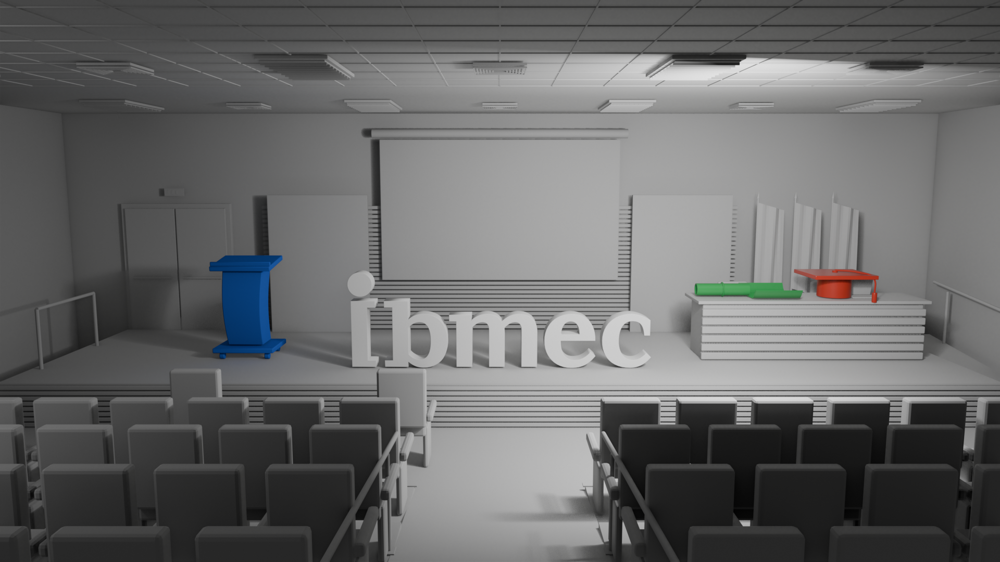

# AC04 — Relatório: evolução da cena com modelos de iluminação

**Disciplina:** Computação Gráfica I · **Professor:** Jonh Edson
**Atividade:** [AC04 — Evolução da Cena: Modelos de Iluminação](https://jonh-carvalho.github.io/CG_26.2_8001/Avalia/AC04/) · Blender 4.5 LTS

## Arquivos da entrega

| Arquivo | Conteúdo |
|---|---|
| [`AC04_IgorMariano.blend`](AC04_IgorMariano.blend) | cena da AP1 evoluída, com os três materiais e a iluminação; os scripts ficam guardados no editor de texto do arquivo |
| [`AC04_IgorMariano_render_final.png`](AC04_IgorMariano_render_final.png) | render da `Camera_Principal`, 1920×1080, EEVEE |
| [`scripts/`](scripts/) | `01_continuidade_ap1.py` → `04_render_final.py`, executados em sequência por `executar_ac04.py` |



## 1. Continuidade da AP1

O script `01` abre `AP1/AP1_IgorRodrigues.blend` e o salva como cópia `AC04_IgorMariano.blend`. Os scripts `02` a `04` só rodam sobre essa cópia, então o arquivo da AP1 não é alterado — o SHA-256 dele é o mesmo antes e depois da execução. Foram mantidos a composição, a `Camera_Principal` (28 mm, em (0; 13,2; 3,15)), os 221 objetos da AP1 e a `Marca_Ibmec` com o seu material `AP1_Cinza_Claro_Marca`. A comparação é feita apenas nos três objetos autorais.

```
AP1_Ibmec_Conceito
├── Marca              Marca_Ibmec (inalterada)
├── Objetos_Autorais   púlpito, capelo e diploma, agora com MAT_*
├── Cenario
├── Camera_Luzes       câmeras e as três luzes da AP1 (desativadas)
└── AC04_Iluminacao    Luz_Principal_Area e Luz_Preenchimento_Area
```

No Blender, materiais não pertencem a coleções: são blocos de dados ligados às malhas. Por isso eles seguem o prefixo `MAT_`, e cada objeto autoral guarda a propriedade `AC04_material` com o nome do material recebido.

O motor passou do Workbench, usado na AP1 só para visualizar as formas, para o **EEVEE** (128 amostras, sombras e *raytracing* ativos), que calcula as componentes difusa e especular. O gerenciamento de cor é **AgX**, que comprime os brilhos sem estourar o branco.

## 2. Objetos e materiais

| Objeto autoral (AP1) | Material | Cor-base (sRGB) | Roughness | Specular IOR Level |
|---|---|---|:---:|:---:|
| `Objeto_A_Pulpito_Pitch` — púlpito | `MAT_Lambert` | azul médio `#3366CC` | 1.0 | 0.0 |
| `Objeto_B_Capelo_Formatura` — capelo | `MAT_Phong` | vermelho `#C0392B` | 0.2 | 0.5 |
| `Objeto_C_Diploma_Ibmec` — diploma | `MAT_BlinnPhong` | verde `#2E9E4F` | 0.1 | 0.8 |

Os três são um **Principled BSDF** ligado ao `Material Output`, com `Metallic` 0, `IOR` 1,5 e `Diffuse Roughness` 0 — ou seja, a mesma componente difusa lambertiana nos três. Rugosidade e especular são os das práticas da aula 11 (2.1, 2.2 e 2.3); as cores foram convertidas de sRGB para linear antes de preencher o `Base Color`.

No Blender 4.5, o campo *Specular* das práticas se chama **Specular IOR Level**. Em 0,5 ele mantém a refletância do IOR: 4 % na incidência normal, para IOR 1,5. Em 0 ele remove o especular, e em 0,8 multiplica essa refletância por 1,6, chegando a ≈ 6,4 %.

O `MAT_Lambert` também contém um nó **Diffuse BSDF** (mesma cor, Roughness 0), desconectado, como a alternativa direta citada no enunciado. Para usá-lo, basta ligá-lo ao `Surface` ou trocar `LAMBERT_COM_DIFFUSE_BSDF` para `True` no script `03`.

Como no passo *Shade Smooth* das práticas, as três malhas receberam sombreamento suave por ângulo (30°). O corpo curvo do púlpito, a copa do capelo e o canudo do diploma ficam lisos, e as arestas vivas continuam vivas; a geometria da AP1 não mudou.

## 3. Iluminação

| | Luz principal | Luz de preenchimento |
|---|---|---|
| Objeto | `Luz_Principal_Area` | `Luz_Preenchimento_Area` |
| Tipo e forma | Area, disco | Area, disco |
| Tamanho | 1 m | 4 m |
| Potência | 300 W | 50 W |
| Cor | branca (1; 1; 1) | branca (1; 1; 1) |
| Abertura (*spread*) | 120° | 180° |
| Posição (m) | (−2,5; 6,5; 3,2) | (5,5; 9,0; 3,8) |
| Apontada para | (−1,5; 2,2; 1,3) | (0; 2; 1) |
| Sombras | sim | sim |

O ambiente (*World*) é uma cor uniforme de 0,05 com força 1, só para que as sombras não fiquem pretas sem criar reflexos próprios nos materiais. As três luzes neutras da AP1 continuam no arquivo, mas desativadas no viewport e no render. Nenhum desses valores muda entre imagens.

**Por que Area e não Sun.** O auditório da AP1 é fechado: o forro está a 4,2 m e bloquearia uma luz direcional. A luz principal é pequena (1 m) para produzir brilho concentrado e sombras definidas, como a das letras sobre o palco e a do púlpito no piso.

**Ângulos diferentes em cada objeto.** A luz principal fica à frente do palco, do lado da mesa, inclinada 23° para baixo. Por isso ela chega a cada objeto autoral por uma direção diferente em relação à câmera:

| Objeto | Distância à luz | Ângulo entre a luz e a câmera, visto do objeto |
|---|:---:|:---:|
| Púlpito | 7,8 m | 35,6° — luz lateral |
| Capelo | 5,3 m | 11,1° — luz quase alinhada com a câmera |
| Diploma | 4,9 m | 12,8° — luz quase alinhada com a câmera |

**Ajuste da posição.** A luz foi posicionada por renders de prévia, mudando um parâmetro de cada vez:

- Com 2 500 W, a cena estourou: as paredes ficaram brancas e a palavra Ibmec perdeu contraste. Com 300 W, o palco fica claro e a plateia, mais escura, sem saturar.
- Com a luz mais alta (3,8 m) e centralizada, os brilhos da copa e do canudo quase não apareciam. O vetor médio **H** entre a luz e a câmera ficava inclinado demais para cima em relação às normais dessas superfícies, que são quase horizontais.
- Baixando a luz para 3,2 m e levando-a para o lado da mesa, H passou a ficar 12° a 14° acima da horizontal, perto das normais do topo do canudo e da copa, e os brilhos apareceram para a câmera.
- Trocar o disco de 1 m por um de 2 m não mudou a imagem de forma perceptível.

## 4. Comparação das aparências

Observações no render final, com a mesma luz e a mesma câmera:

- **Lambert — púlpito azul.** Totalmente fosco, sem nenhuma mancha de brilho. A variação de tom vem só do ângulo entre a normal e a luz (`N·L`): o tampo e as faces mais voltadas para a luz ficam mais claros, e a transição no corpo curvo é contínua. Como a componente difusa não depende do observador, o púlpito teria o mesmo sombreamento visto de qualquer câmera.
- **Phong — capelo vermelho.** Sobre a mesma base difusa aparece um brilho largo e de baixo contraste na metade da copa voltada para a luz, além de um realce fino na borda frontal da placa. A superfície parece um plástico semibrilhante.
- **Blinn-Phong — diploma verde.** O brilho é uma faixa estreita e mais intensa ao longo do topo do canudo e na borda curvada da folha; o reflexo quase reproduz o disco da luz. É o material de aspecto mais polido.

**Efeito da rugosidade.** No Principled BSDF, a *Roughness* r controla a largura do lobo especular, com α = r². Pela equivalência aproximada entre microfacetas e o expoente de Blinn-Phong, n ≈ 2/α² − 2 (Walter et al., 2007), r = 0,2 equivale a n ≈ 1 250 e r = 0,1 a n ≈ 20 000. A meia-largura do lobo, medida no ângulo entre N e H, fica então em torno de 1,9° no Phong e 0,5° no Blinn-Phong.

Visto dos objetos, o disco de 1 m tem ≈ 11° de diâmetro aparente, o que espalha H por cerca de ±2,8°. Por isso o tamanho do brilho é dado principalmente pelo tamanho da luz, e a rugosidade decide a nitidez da borda: borrada no Phong, quase nítida no Blinn-Phong. A diferença de intensidade vem do *Specular IOR Level*: o Blinn-Phong reflete ≈ 1,6 vez mais (6,4 % contra 4 %). No Lambert (r = 1, IOR Level 0) não há lobo especular algum.

**Influência do ângulo da luz.** O brilho especular só aparece onde a normal fica perto de H, que depende da luz e do observador ao mesmo tempo. A difusa depende apenas da luz. Isso ficou visível no ajuste da seção 3: baixar a luz 0,6 m e deslocá-la cerca de 2 m em direção à mesa fez surgir os brilhos do capelo e do diploma, sem mudar o aspecto fosco do púlpito. Na copa, que é um cilindro vertical, H fica ~12° fora das normais horizontais. O lobo mais largo do Phong ainda capta esse brilho, de forma suave; um lobo estreito como o do Blinn-Phong precisaria de um alinhamento mais preciso.

**Cuidados na leitura.**

- O púlpito está mais longe da luz e a recebe de lado: recebe cerca de 40–45 % da irradiância do capelo e do diploma (1/d²). Parte do seu tom mais escuro vem disso, e não do modelo.
- No enquadramento principal os objetos são pequenos (o capelo ocupa cerca de 160 px de largura), então os brilhos aparecem pequenos. As câmeras de detalhe do arquivo (`Camera_Detalhe_Capelo`, `Camera_Detalhe_Diploma`, `Camera_Detalhe_Pulpito`) mostram as diferenças de perto, com a mesma iluminação.

## 5. Phong e Blinn-Phong no Principled BSDF são aproximações

Os modelos clássicos são empíricos:

- **Lambert:** `I = kd · IL · max(0, N·L)`
- **Phong:** `I = ka·Ia + kd · IL · (N·L) + ks · IL · (R·V)^n`, com R o reflexo de L em torno de N
- **Blinn-Phong:** troca `(R·V)^n` por `(N·H)^n`, com `H = (L + V) / |L + V|`

O **Principled BSDF** do Blender 4.5 não implementa essas equações. Ele combina uma difusa lambertiana (com `Diffuse Roughness` 0) com um especular de microfacetas **GGX com multiespalhamento**, Fresnel dependente do ângulo e conservação de energia entre as camadas. Nenhum de seus parâmetros é `ks`, `n` ou o vetor R ou H explícito: a *Roughness* define a distribuição das microfacetas, e o *Specular IOR Level* escala a refletância de Fresnel.

Assim, `MAT_Phong` e `MAT_BlinnPhong` são o **mesmo shader com parâmetros diferentes**, e os nomes se referem à aparência pedida no enunciado: brilho mais largo ou mais concentrado. A distribuição GGX é, inclusive, função de `N·H`, mais próxima da ideia do Blinn-Phong do que da do Phong. O termo ambiente `ka·Ia` também não existe como parâmetro: o ambiente aqui vem do *World* e da luz indireta. Só a difusa do `MAT_Lambert` coincide com o modelo clássico — e o nó Diffuse BSDF com Roughness 0 deixado no material é a forma literal de Lambert.

## 6. Escopo desta versão

Esta entrega cobre a continuidade da AP1, as atividades 1 e 2, o `.blend` e o render final. A **etapa 3** não faz parte da automação e ainda não foi feita como experimento próprio. Ela consiste em observar a cena no modo *Rendered*, girar a luz temporariamente e restaurá-la depois. Por isso a **imagem comparativa** dos três objetos (entregável 3) ainda não está na pasta. As observações sobre o ângulo da luz na seção 4 vêm das prévias feitas durante o ajuste da iluminação.

## Como reproduzir

Na interface: abra `AP1/AP1_IgorRodrigues.blend` no Blender 4.5 LTS, aba *Scripting*, carregue `AC4/scripts/executar_ac04.py` e execute com `Alt+P`. Sem abrir a interface, a partir da raiz do repositório:

```bash
blender -b AP1/AP1_IgorRodrigues.blend --python AC4/scripts/executar_ac04.py
```

## Referências

* **Práticas da aula 11:** [cena](https://jonh-carvalho.github.io/CG_26.2_8001/Disciplina/docs/aula11/pratica/01_cena/) · [Lambert](https://jonh-carvalho.github.io/CG_26.2_8001/Disciplina/docs/aula11/pratica/2.1_lambert/) · [Phong](https://jonh-carvalho.github.io/CG_26.2_8001/Disciplina/docs/aula11/pratica/2.2_phong/) · [Blinn-Phong](https://jonh-carvalho.github.io/CG_26.2_8001/Disciplina/docs/aula11/pratica/2.3_blinn-phong/)
* **Base:** [AP1 — Conceito e Modelagem da Peça “Ibmec em 15 segundos”](https://jonh-carvalho.github.io/CG_26.2_8001/Avalia/ap1/) e [`AP1/AP1_IgorRodrigues.blend`](../AP1/AP1_IgorRodrigues.blend)
* **Blender 4.5:** [Principled BSDF](https://docs.blender.org/manual/en/4.5/render/shader_nodes/shader/principled.html) · [Luzes](https://docs.blender.org/manual/en/4.5/render/lights/light_object.html) · [API Python (`bpy`)](https://docs.blender.org/api/current/)
* **Modelos clássicos:** B. T. Phong, *Illumination for Computer Generated Pictures*, Communications of the ACM, 1975 · J. F. Blinn, *Models of Light Reflection for Computer Synthesized Pictures*, SIGGRAPH, 1977 · B. Walter et al., *Microfacet Models for Refraction through Rough Surfaces*, EGSR, 2007
