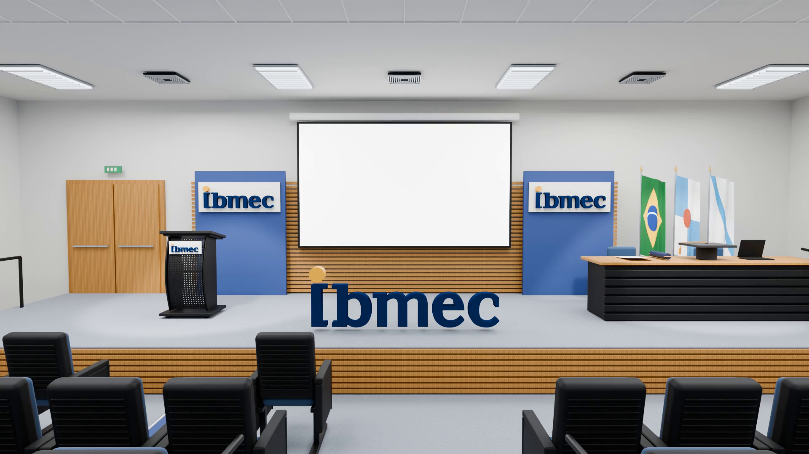
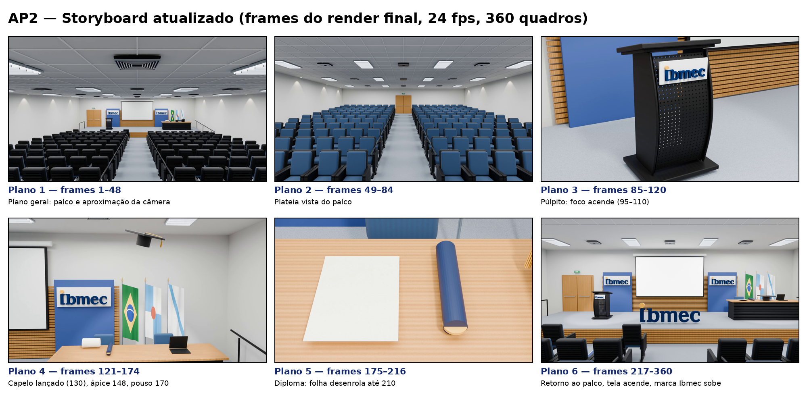
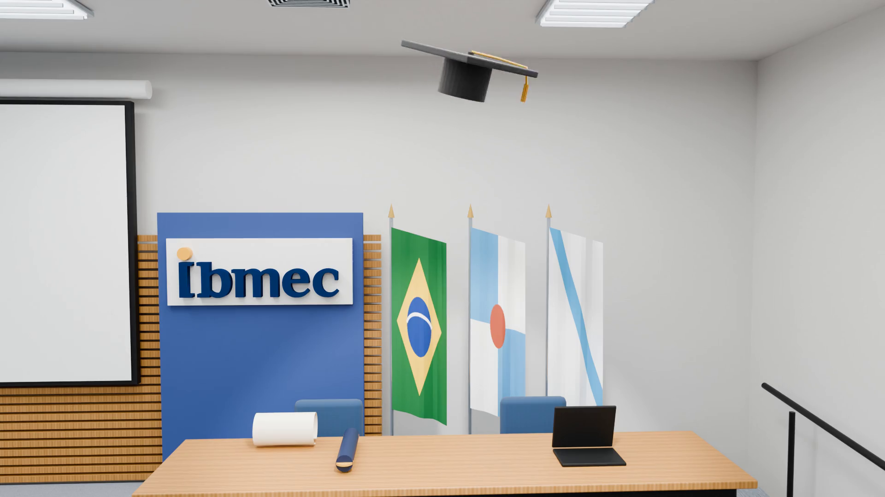

# AP2 — “Ibmec: Da Plateia ao Palco da Vida Profissional”

**Aluno:** Igor Mariano Lopes Rodrigues · **Matrícula:** 202407095992
**Curso:** Engenharia de Software · **Disciplina:** Computação Gráfica (26.2)
**Software:** Blender 4.5 LTS · **Arquivo:** `AP2_IgorRodrigues.blend` · **Vídeo:** `AP2_IgorRodrigues.mp4`

*Quadro 300 do render final: a marca Ibmec ergue-se no palco, entre o púlpito e a mesa onde repousam o capelo e o diploma.*

---

## Entregáveis

| Item solicitado | Arquivo |
| --- | --- |
| Cena com animações, materiais, texturas, iluminação, câmera e saída | `AP2_IgorRodrigues.blend` |
| Vídeo final — 15 s, 24 fps | `AP2_IgorRodrigues.mp4` (H.264, 1920×1080, 360 quadros) |
| Imagem renderizada | `renders/AP2_IgorRodrigues_frame_representativo.png` (quadro 300) e `renders/AP2_IgorRodrigues_frame_capelo.png` (quadro 150) |
| Storyboard atualizado | `storyboard/AP2_IgorRodrigues_storyboard.png` |
| Relatório | `relatorio.md` |
| Texturas da AC05 e licença | `texturas/` e `texturas/FONTES_E_LICENCA.json` |

---

## 1. Título, conceito e resumo da sequência

### Da AP1 à AP2: o auditório ganha vida

Todo aluno do Ibmec já se sentou numa das poltronas do auditório para assistir a alguém no palco. A pergunta que guiou este projeto desde a AP1 foi simples: **e quando chega a nossa vez de subir?**

Na AP1, essa ideia virou um auditório modelado em cinza, estático, com três objetos autorais que resumem a trajetória do aluno:

- **o púlpito** — *apresentar*: o momento em que o aluno ganha voz;
- **o capelo** — *conquistar*: a formatura;
- **o diploma** — *atuar*: a formação concluída que abre a vida profissional.

Na AC05, essas superfícies ganharam texturas de madeira e tecido. Na **AP2**, a cena finalmente se move: a câmera percorre o auditório, as luzes guiam o olhar, o capelo voa, o diploma se abre e a marca Ibmec assume o palco. O conceito e os três objetos da AP1 foram preservados; o que muda é que agora eles contam a história no tempo.

### Resumo em uma frase

Em 15 segundos, o espectador sai da plateia, sobe ao palco, passa pelos três símbolos da trajetória acadêmica — apresentar, conquistar e atuar — e termina diante da marca Ibmec.

---

## 2. Momentos, planos e ações animadas

*Storyboard atualizado, montado com quadros do render final, no mesmo layout do storyboard da AP1.*

A sequência foi organizada em **três atos**, distribuídos em seis planos e quatro câmeras:

### Ato I — A plateia (0–3,5 s)

**Plano 01 · frames 1–48 · 0–2 s — Plano geral.** A peça abre do fundo do auditório, de onde todo aluno começa. A câmera avança lentamente pelo corredor central e mostra o palco com a tela, os painéis com a marca, o púlpito e a mesa. É o plano de apresentação do espaço.

**Plano 02 · frames 49–84 · 2–3,5 s — Plateia vista do palco.** Contraplano: pela primeira vez, vemos o auditório de cima do palco. As poltronas azuis vazias mostram o lugar de onde o aluno veio. Esse plano é a virada de ponto de vista da narrativa: o espectador deixou de ser plateia.

### Ato II — A trajetória (3,5–9 s)

**Plano 03 · frames 85–120 · 3,5–5 s — Púlpito (*apresentar*).** Close no púlpito preto com a marca Ibmec. Entre os quadros 95 e 110, um foco acende sobre ele. A luz representa o momento em que o aluno ganha voz.

**Plano 04 · frames 121–174 · 5–7,25 s — Capelo (*conquistar*).** O capelo é lançado no quadro 130, sobe em arco, atinge o ápice no 148 e pousa sobre a mesa no 170. É o gesto clássico da formatura e o ponto de maior energia da peça.

**Plano 05 · frames 175–216 · 7,25–9 s — Diploma (*atuar*).** Plano de detalhe sobre a mesa: a folha, inicialmente enrolada, se desenrola até ficar aberta no quadro 210, ao lado do canudo azul. A formação está concluída.

### Ato III — O palco (9–15 s)

**Plano 06 · frames 217–360 · 9–15 s — Marca e plano final.** A câmera volta ao palco. A tela acende até o quadro 242, e a marca Ibmec sobe do palco até o quadro 277. O plano se estabiliza nos últimos segundos para que a marca seja lida com calma. A sequência fecha onde começou — no auditório —, mas agora com o palco ocupado pela instituição.

### Imagens renderizadas

| Quadro 150 — Capelo no ar (*conquistar*) | Quadro 300 — Marca Ibmec no palco (plano final) |
| --- | --- |
|  |  |

*Quadros extraídos do vídeo final renderizado em Cycles (1920×1080). O quadro 150 mostra o capelo logo após o ápice do lançamento; o quadro 300 é o frame representativo da peça, com a marca já posicionada e o plano estabilizado.*

### O que mudou em relação ao storyboard da AP1

| AP1 (planejado) | AP2 (implementado) | Motivo |
| --- | --- | --- |
| 01 Plateia, 0–3 s | 01 Plano geral (0–2 s) + 02 Plateia vista do palco (2–3,5 s) | O contraplano deixa explícita a passagem da plateia ao palco. |
| 02 Púlpito, 3–5 s | 03 Púlpito, 3,5–5 s | Mantido; ganhou o foco de luz animado. |
| 03 Capelo, 5–7 s | 04 Capelo, 5–7,25 s | Mais ¼ s para o pouso respirar. |
| 04 Diploma, 7–9 s | 05 Diploma, 7,25–9 s | Mantido. |
| 05 Marca, 9–10 s + 06 Plano final, 10–15 s | 06 Marca e plano final, 9–15 s | Unificados num só plano contínuo, sem corte entre a entrada da marca e a leitura final. |

---

## 3. Propriedades animadas e decisões de timing e interpolação

### Propriedades animadas

| Elemento | Propriedades | Intenção |
| --- | --- | --- |
| Câmeras (4) | Posição, rotação, distância focal; troca por marcadores na timeline | Conduzir o olhar da plateia ao palco. |
| Capelo | Translação e rotação | Arco de lançamento com subida, ápice e pouso. |
| Diploma | *Shape key* (enrolada → aberta) | Mostrar a formação “se abrindo”. |
| Foco do púlpito | Intensidade da luz | Marcar o momento de fala. |
| Tela | Intensidade da emissão | Anunciar o encerramento. |
| Marca Ibmec | Translação e escala | Entrada da marca como clímax visual. |

### Interpolação

- **Bézier com alças *Auto Clamped*** em todos os movimentos contínuos: geram aceleração e desaceleração naturais (*ease in/ease out*) sem ultrapassar os valores-alvo. No capelo, isso faz o objeto desacelerar no ápice, como sob efeito da gravidade, e assentar suavemente no pouso. No diploma, a abertura começa e termina com suavidade, como papel de verdade.
- **Constant** nos cortes de câmera: a troca entre câmeras acontece de um quadro para o outro, sem deslizamento indesejado entre planos.

### Timing

A 24 fps, cada um dos três símbolos recebe entre **36 e 54 quadros (1,5 a 2,25 s)** — tempo suficiente para o objeto ser reconhecido sem deixar o ritmo cair. O capelo, por ser o ponto de maior energia, tem o plano mais longo do Ato II. O plano final ocupa **6 s**, sendo os últimos ~3,5 s (quadros 277–360) estáveis, para que a marca seja lida com clareza antes do fim.

---

## 4. Iluminação e renderização

### Iluminação

A iluminação foi pensada em três camadas, seguindo o auditório real fotografado na AP1:

1. **Luz geral — 20 luzes AREA (45 W)** alinhadas às luminárias retangulares do forro, cujas superfícies também receberam emissão. A luz vem de onde o espectador vê que ela vem, deixando a cena coerente.
2. **Luz de ambiência — 12 SPOT (24 W)** junto às paredes, com aros e lentes modelados, criando os gradientes suaves que dão profundidade às paredes brancas.
3. **Luz narrativa — 2 luzes animadas** (foco do púlpito e emissão da tela) que guiam o olhar nos momentos-chave.

Os preenchimentos herdados da versão anterior foram reduzidos de **420 W para 120 W** e o World foi moderado, evitando que as paredes brancas estourassem e preservando as sombras de contato sob as poltronas.

### Renderização e saída

| Configuração | Valor |
| --- | --- |
| Motor | Cycles |
| Amostragem | 128 amostras, amostragem adaptativa, *denoising* |
| Gestão de cor | AgX |
| Resolução | 1920×1080 (16:9) |
| Taxa de quadros | 24 fps |
| Intervalo | quadros 1–360 (15 s) |
| Saída | MPEG-4 / H.264, sem áudio |

---

## 5. Materiais e texturas reaproveitados ou ajustados da AC05

A AC05 produziu dois conjuntos de mapas PBR autorais — **madeira** e **tecido** (BaseColor, Normal e Roughness, 1024×1024). Na AP2, eles foram reaproveitados e ajustados para a paleta da marca: **azul, preto, madeira e branco**.

| Superfície | Material | Origem |
| --- | --- | --- |
| Mesa e painéis ripados | Madeira em tom natural | AC05 — madeira (reaproveitada) |
| Púlpito | Madeira escurecida até o preto, com veios sutis; perfurações e logotipo preservados | AC05 — madeira (ajustada) |
| Estofados das poltronas | Tecido remapeado para o azul da marca, com trama discreta | AC05 — tecido (ajustado) |
| Laterais e base das poltronas | Plástico preto fosco | Novo |
| Ferragens próximas às poltronas | Ferro pintado preto, reflexão suave | Novo |
| Paredes | Branco levemente quente, rugosidade alta | Novo |
| Capelo | Tecido preto (Oxford), rugosidade alta; borla preservada | Novo |
| Diploma | Papel claro com microvariação procedural de cor e relevo | Substitui o acabamento metálico da AC05 |

**Decisões técnicas:**

- BaseColor em **sRGB** e Roughness em **Non-Color**, ligados ao **Principled BSDF (GGX)**.
- Projeção **BOX** com coordenadas *Generated*: dispensa refazer UVs e acompanha os objetos animados.
- Relevo por **Bump**. Os mapas Normal da AC05 acompanham o pacote, mas não foram ligados como normal tangente, pois a projeção BOX não oferece tangentes consistentes.
- O papel do diploma usa **Diffuse BSDF** (roughness 0, comportamento Lambertiano) misturado com pequena parcela PBR, para parecer fosco como papel real.
- Todas as imagens estão **empacotadas no `.blend`** e também disponíveis em `texturas/`, com caminhos relativos.

---

## 6. Desafios encontrados e soluções adotadas

| Desafio | Solução |
| --- | --- |
| Várias versões da cena (V1, V2, correções de câmera) sem histórico claro de qual era a mais recente. | Comparação dos arquivos por hash SHA-256; escolhida como base a revisão multicâmera mais recente. |
| Aplicar plástico às laterais das poltronas sem deformar a malha. | Análise dos eixos locais e reatribuição de materiais por face, sem mover vértices. |
| Caminhos das texturas quebrando ao salvar em outra pasta. | Remapeamento automático desativado, caminhos relativos `//texturas/` conferidos após reabrir o arquivo e imagens empacotadas no `.blend`. |
| Paredes brancas estourando com a iluminação herdada. | Preenchimentos reduzidos de 420 W para 120 W, World moderado e gestão de cor AgX. |
| Custo de renderizar 360 quadros em Cycles. | Versão de teste em 1200×800 para validar planos e iluminação; render final em 1920×1080, mantendo 24 fps e 15 s. |

---

## 7. Fontes e licenças

- **Cena, modelagem, animação, storyboard e conceito:** autoria própria (AP1 e AP2).
- **Texturas da AC05** (madeira e tecido — BaseColor, Normal e Roughness): mapas sintéticos gerados pelo script autoral `scripts/gerar_texturas.py`, com assistência de IA, licença **CC0-1.0** (ver `texturas/FONTES_E_LICENCA.json`). Nenhuma imagem de terceiros foi usada como textura.
- **Fotografias do auditório** (plateia, corredor, palco e púlpito): fornecidas pelo aluno, usadas apenas como referência visual de proporções e cores.
- **Marca Ibmec e bandeiras:** marca da instituição, usada exclusivamente para fins acadêmicos nesta atividade; a geometria da logo vem do arquivo `Logo-Ibmec-3D.blend` da AP1.
- **Software e documentação:** Blender 4.5 LTS (GPL); manual oficial do Blender — [Diffuse BSDF](https://docs.blender.org/manual/en/4.5/render/shader_nodes/shader/diffuse.html) e [Principled BSDF](https://docs.blender.org/manual/en/4.5/render/shader_nodes/shader/principled.html).
- **Uso de IA:** assistentes de IA apoiaram a escrita de scripts de preparo, a geração das texturas e a revisão deste relatório. As decisões de conceito, composição, animação e validação visual são do autor.
