<div align="center">

# 🎨 Computação Gráfica 

### 📚 Estudos Dirigidos

**Disciplina:** Computação Gráfica &nbsp;·&nbsp; **Professor:** Jonh Edson


</div>

---

Este repositório reúne os arquivos de entrega, os scripts e os resultados das atividades. Cada pasta tem sua documentação própria. **AP1 → AC4 → AC5** formam uma sequência: a modelagem original evolui para iluminação e, depois, para materiais PBR e texturas. As cenas anteriores são preservadas; este README apresenta o índice e os principais resultados versionados.

## 🗂️ Índice das entregas

| # | 🧩 Tema | 🛠️ Ferramentas | 📊 Estado |
|:---:|---|---|:---:|
| [**AC1**](AC1/) | 🔍 As quatro áreas da Computação Visual | ModernGL · OpenCV · YOLOv8 · VTK | ✅ **concluída** |
| [**AC2**](AC2/) | 📐 Transformações geométricas 2D | NumPy · Matplotlib | ✅ **concluída** |
| [**AC3**](AC3/) | 🧊 Transformações 2D/3D no Blender | Blender 4.5 LTS | ✅ **concluída** |
| [**AP1**](AP1/) | 🧱 Modelagem do auditório do Ibmec Barra - RJ | Blender 4.5 LTS | ✅ **concluída** |
| [**AC4**](AC4/) | 💡 Modelos de iluminação: Lambert, Phong e Blinn-Phong | Blender 4.5 LTS · EEVEE |✅ **concluída**  |
| [**AC5**](AC5/) | 🪵 Materiais PBR, texturas e UVs | Blender 4.5.3 LTS · Cycles · Python | ✅ **concluída** |


```
📦 AC-Computação-Gráfica
├── 📁 AC1/    🔍 quatro áreas       → 4 programas + relatório em PDF/HTML
├── 📁 AC2/    📐 transformações 2D  → 10 exercícios + 14 figuras
├── 📁 AC3/    🧊 Blender            → cena .blend + script bpy + 2 imagens
├── 📁 AP1/    🏛️ Auditório Ibmec    → cena .blend + relatório + capturas e storyboard
├── 📁 AC4/    💡 iluminação         → cena .blend + 4 etapas bpy + executor + render + relatório
├── 📁 AC5/    🪵 materiais e UVs     → cena .blend + 3 scripts + 6 mapas + render + 2 capturas + relatório
└── 📁 docs/   📚 material da disciplina (não versionado)
```

---

## 🔍 AC1 — As quatro áreas da Computação Visual

> 🎯 **Objetivo** ([`AC1/AC01.md`](AC1/AC01.md)): demonstrar as diferenças e as principais características de Síntese de Imagens, Processamento de Imagens, Visão Computacional e Visualização Computacional — selecionando uma aplicação por área e **executando código de repositório público**, com explicação dos aspectos específicos de cada uma.

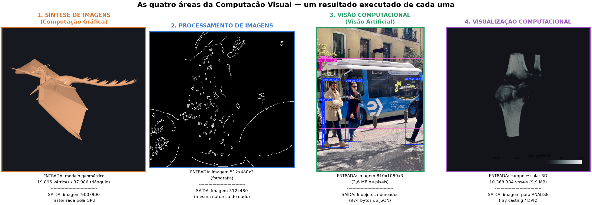

Quatro programas, um por área, todos executados de ponta a ponta (⏱️ ≈ 22 s no total). A tese que organiza a entrega é que cada área se define pelo par *(o que entra, o que sai)*:

| | 🧭 Área | 💻 Aplicação executada | ➡️ Entrada → saída, medidas na execução |
|:---:|---|---|---|
| 1️⃣ | **Síntese de Imagens** | pipeline OpenGL 3.3 Core via **ModernGL**, renderizando `dragao.obj` | 19.895 vértices → imagem 900×900 em 0,9 ms |
| 2️⃣ | **Processamento de Imagens** | **OpenCV**: aquisição, realce, restauração, convolução, segmentação | imagem 512×480×3 → imagem 512×480 |
| 3️⃣ | **Visão Computacional** | **YOLOv8n** (Ultralytics), contrastado com HOG + SVM | imagem de 2,6 MB → 6 objetos em 974 bytes |
| 4️⃣ | **Visualização Computacional** | **VTK/PyVista** (cortes, isosuperfície, DVR) + Gapminder no **Matplotlib** | 10,4 M voxels e 142 linhas → imagem para análise |

📄 Entrega em [`AC1/README.md`](AC1/README.md), com o mesmo conteúdo também em [`relatorio.pdf`](AC1/relatorio/relatorio.pdf) (26 páginas) e [`relatorio.html`](AC1/relatorio/relatorio.html). Todos os números vêm de [`relatorio/log_execucao.txt`](AC1/relatorio/log_execucao.txt).

<details>
<summary><b>📖 Referências da AC1</b></summary>

<br>

* **Material:** `aula01/intro.pdf` (sub-áreas da CG) · `aula02/intro_computacao_visual.pdf` (definição das quatro áreas, slides 15, 23, 28, 47, 50 e 66) · `aula02/bibliotecas_graficas.pdf` (OpenGL moderna e o pipeline) · `files/PI.pdf` (Processamento de Imagens) · `aula08/objetos/dragao.obj` (modelo renderizado)
* **Repositórios executados:** [ModernGL](https://github.com/moderngl/moderngl) · [OpenCV](https://github.com/opencv/opencv) · [Ultralytics YOLO](https://github.com/ultralytics/ultralytics) e [assets](https://github.com/ultralytics/assets) · [VTK](https://github.com/Kitware/VTK) · [PyVista](https://github.com/pyvista/pyvista) e [vtk-data](https://github.com/pyvista/vtk-data) · [Matplotlib](https://github.com/matplotlib/matplotlib) · [plotly/datasets](https://github.com/plotly/datasets)
* **Algoritmos:** Phong (1975) · Otsu (1979) · Canny (1986) · Marching cubes, Lorensen & Cline (1987) · HOG, Dalal & Triggs (2005) · YOLO, Redmon et al. (2016)

A lista completa está na [seção 9 do README da AC1](AC1/README.md#9-referências).

</details>

---

## 📐 AC2 — Transformações geométricas 2D

> 🎯 **Objetivo** ([`AC2/AC02.md`](AC2/AC02.md)): resolver e **plotar com Matplotlib** dez exercícios de transformação no plano — translação, escala uniforme e não uniforme, rotação, reflexão, cisalhamento e duas composições.

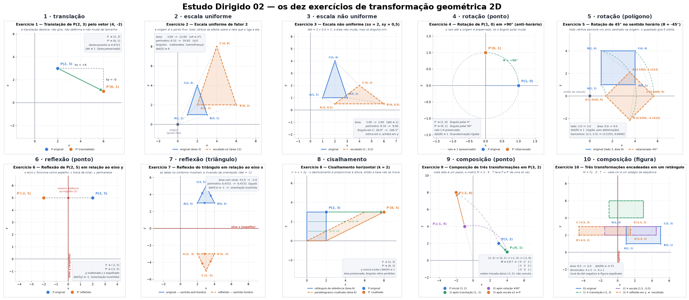

Os dez exercícios foram resolvidos, plotados (🖼️ 14 figuras) e verificados numericamente. A decisão de projeto que organiza a entrega é usar **coordenadas homogêneas 3×3** mesmo num problema plano: a translação não é linear, e só assim as cinco famílias viram o mesmo tipo de objeto e qualquer sequência colapsa em uma matriz só.

Além das respostas, a entrega mede o que cada transformação preserva (área, perímetro, ângulos, orientação) e fecha com **11 verificações algébricas** ✔️ que o `executar_tudo.py` roda ao final — entre elas `Fx · Fy = R(180°)`, a não-comutatividade de `S·R·T`, e `T · R · T⁻¹` como receita para girar em torno de um ponto qualquer.

> [!IMPORTANT]
> A execução **falha** se alguma das 11 verificações não passar.

📄 Entrega em [`AC2/README.md`](AC2/README.md); coordenadas e matrizes em [`saida/resultados.json`](AC2/saida/resultados.json).

<details>
<summary><b>📖 Referências da AC2</b></summary>

<br>

* **Material:** `aula04/tg2d3d.pdf` (transformações 2D/3D e coordenadas homogêneas) · `aula04/Aula5.Ex1 - Transformação Geométrica (Exemplos em 2D).ipynb` (convenção de vetor-coluna com `w = 1`, seguida aqui) · `aula05/tg3d.md` (extensão para matrizes 4×4) · `aula08/Aula7.Ex1 - Transformações Geométricas 3D com a Biblioteca GLM.ipynb` (a mesma composição `M · V · P` em pipeline real)
* **Bibliotecas:** [NumPy](https://github.com/numpy/numpy) (álgebra das matrizes) · [Matplotlib](https://github.com/matplotlib/matplotlib) (plotagem pedida no enunciado)

</details>

---

## 🧊 AC3 — Transformações 2D e 3D no Blender 4.5 LTS

> 🎯 **Objetivo** ([`AC3/AC03.md`](AC3/AC03.md)): montar a mini-cena *"Parque Geométrico"* com objetos 2D (quadrado, triângulo, círculo) e 3D (cubo, cilindro, esfera UV), aplicando translação, rotação e escala pela interface **e** por script Python; distinguir espaço local e global; animar 3 a 6 segundos com keyframes.

| Frame 1 | Frame 120 |
|---|---|
| 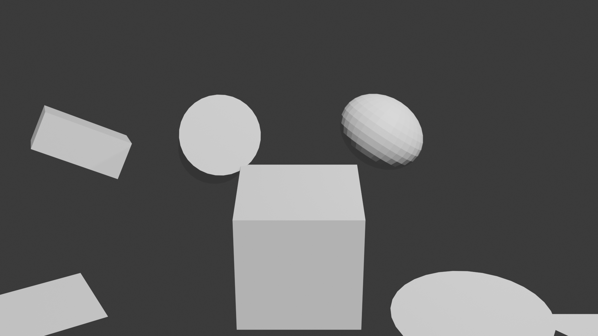 | 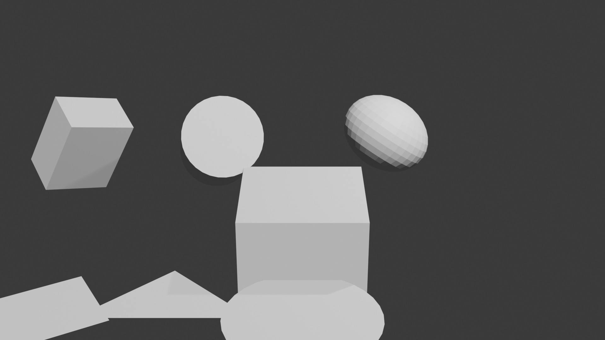 |

A cena reúne seis objetos na coleção `AC03_transformacoes` — três planos no XY e três sólidos — e tudo é construído por script: criação, transformações, hierarquia, keyframes, câmera e luz. Comparando os dois frames, o círculo transladou em X e girou 180° em Z, o cubo mudou de escala e orientação em eixos diferentes, e o triângulo acompanhou o círculo por ser seu **filho** (bônus de transformação composta, junto com o easing `EASE_IN_OUT` e o keyframe intermediário no frame 60).

📦 **Entregáveis:**

| | Item | Arquivo |
|:---:|---|---|
| 🟠 | arquivo `.blend` | [`AC03_IgorMariano.blend`](AC3/AC03_IgorMariano.blend) |
| 🐍 | script Python | [`AC03_IgorMariano.py`](AC3/AC03_IgorMariano.py) |
| 🖼️ | renders da cena (1920×1080) | [`cena_inicial.png`](AC3/AC03_IgorMariano_cena_inicial.png) · [`cena_final.png`](AC3/AC03_IgorMariano_cena_final.png) |
| 📝 | texto de entrega | [`AC03_Relatorio.md`](AC3/AC03_Relatorio.md) |
| ❓ | cinco questões teóricas | [`AC03_Questoes_Teoricas.md`](AC3/AC03_Questoes_Teoricas.md) |

As imagens são renders de câmera (`F12`) em 1920×1080, com sombras projetadas pela luz *sun* — o entregável de imagem renderizada está atendido.

<details>
<summary><b>📖 Referências da AC3</b></summary>

<br>

* **Material:** `aula04/tg2d3d.pdf` e `aula05/tg3d.md` (a teoria das transformações que a atividade exercita na prática) · `aula04/Aula5.Ex3–Ex6` (cubo, pirâmide, cilindro e esfera em transformações 3D) · `blender/blender.md` e `blender/modelagem.md` · `blender/scripts/02_cube_transform.py`, `05_rotation_scale_animation.py`, `08_parenting_hierarchy.py` e `09_render_sequence.py` (base direta da automação, da animação, da hierarquia e do render)
* **Externas:** [Blender Python API (`bpy`)](https://docs.blender.org/api/current/) · [Blender Manual](https://docs.blender.org/manual/en/latest/)
* **Nesta pasta:** [`AC03_Relatorio.md`](AC3/AC03_Relatorio.md) (texto de entrega, com as duas imagens lado a lado) · [`AC03_Questoes_Teoricas.md`](AC3/AC03_Questoes_Teoricas.md) (as cinco questões)

</details>

---

## 🏛️ AP1 — Conceito e modelagem: *Ibmec em 15 segundos*

> 🎯 **Objetivo** ([`AP1/AP1.md`](AP1/AP1.md)): construir no **Blender 4.5 LTS** a cena-conceito de uma peça de 15 s (24 fps, 360 frames) que destaque a marca **Ibmec**, com **exatamente três objetos autorais**, câmera principal pronta para a AP2 e storyboard de três momentos. A AP1 entrega a composição estática em cinza; a animação fica planejada para a AP2. A iluminação e os materiais são desenvolvidos nas atividades AC4 e AC5.

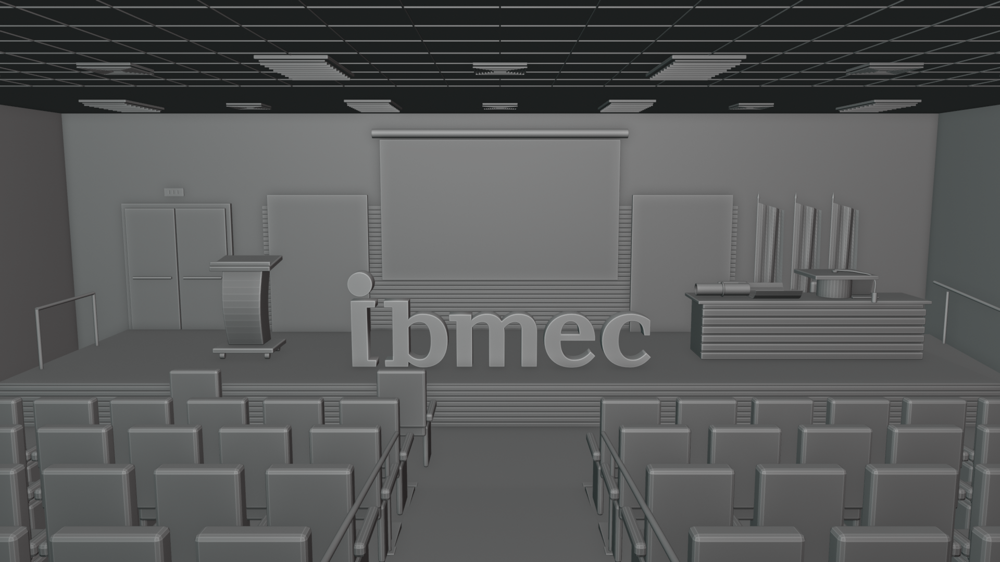

A cena é um auditório de formatura com a marca Ibmec em destaque, na coleção `AP1_Ibmec_Conceito`. A curva original de `Logo-Ibmec-3D.blend` foi reaproveitada sem alterar a forma, só posição, orientação e escala. A entrega é **estática**: os marcadores na timeline só registram o planejamento da AP2.

| Púlpito de pitch | Capelo de formatura | Diploma Ibmec |
|---|---|---|
| 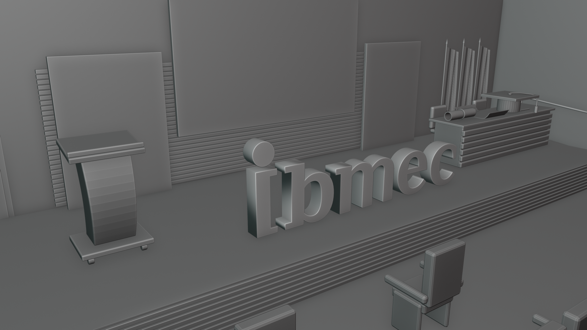 | 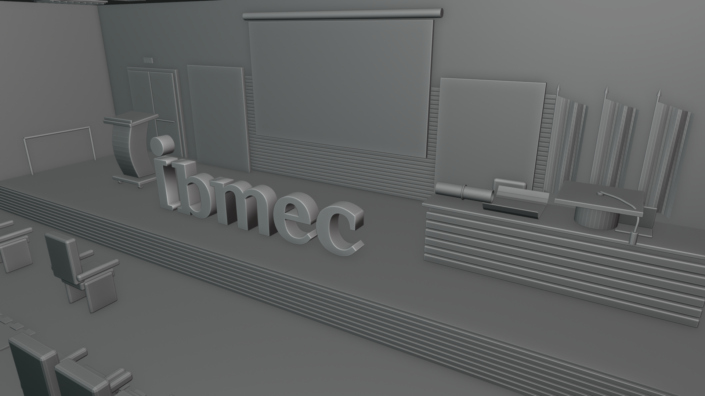 | 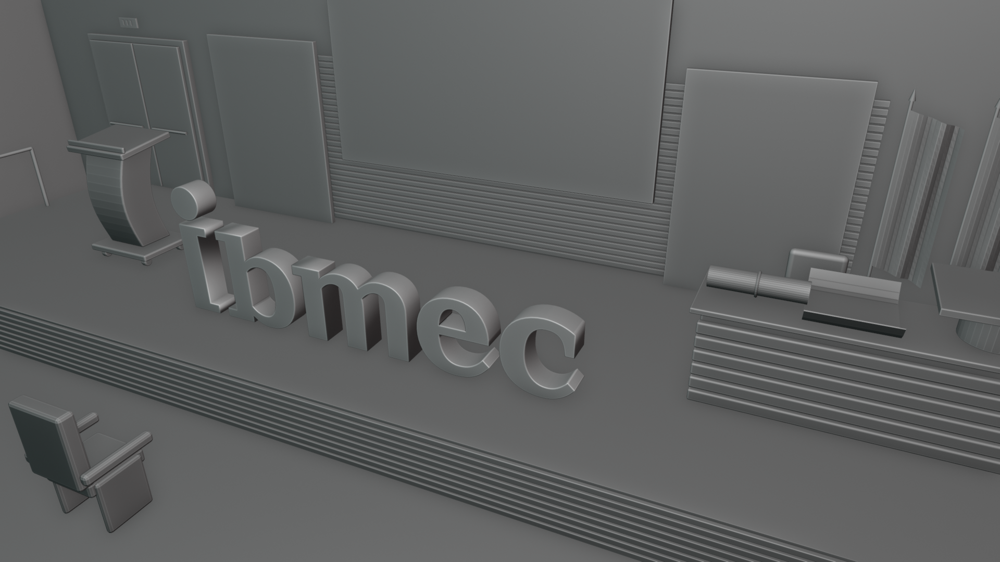 |

As três malhas usam **grupos de vértices** para identificar componentes (a folha do diploma pode ser separada para animar na AP2). Púlpito e capelo mantêm o **Bevel** editável, e o **Solidify** do diploma foi aplicado antes da união das malhas.

📦 **Entregáveis:**

| | Item | Arquivo |
|:---:|---|---|
| 🟠 | arquivo `.blend` | [`AP1_IgorRodrigues.blend`](AP1/AP1_IgorRodrigues.blend) |
| 🖼️ | capturas do enquadramento e dos objetos | [`capturas/`](AP1/capturas/) |
| 🎬 | storyboard de 15 s e guias conceituais | [`conceito/`](AP1/conceito/) |
| 📝 | relatório com a justificativa dos objetos | [`Relatorio_AP1_IgorRodrigues.md`](AP1/Relatorio_AP1_IgorRodrigues.md) |

📄 Detalhes de uso e de modelagem em [`AP1/README.md`](AP1/README.md).

O conceito **“Ibmec: Da Plateia ao Palco da Vida Profissional”** usa o corredor central para conduzir o olhar ao palco. Os três objetos representam **apresentar → conquistar → atuar**. A imagem principal da AP1 é uma visualização real em **Workbench**; os arquivos de `conceito/` são ilustrações de planejamento, identificadas no relatório. Os nomes históricos `IgorRodrigues` foram mantidos nos arquivos da AP1; as cópias da AC4 e da AC5 usam `IgorMariano`.

<details>
<summary><b>📖 Referências da AP1</b></summary>

<br>

* **Imagens de referência:** [`AP1/referencias/`](AP1/referencias/) (plateia, corredor central, palco e púlpito reais), usadas no processo de modelagem
* **Marca:** [`Logo-Ibmec-3D.blend`](AP1/Logo-Ibmec-3D.blend), curva original reaproveitada
* **Externas:** [Blender Manual](https://docs.blender.org/manual/en/latest/)

</details>

---

## 💡 AC4 — Evolução da cena: modelos de iluminação

> 🎯 **Objetivo** ([enunciado no site da disciplina](https://jonh-carvalho.github.io/CG_26.2_8001/Avalia/AC04/)): evoluir a cena da AP1 no **Blender 4.5 LTS** aplicando materiais inspirados nos modelos **Lambert**, **Phong** e **Blinn-Phong** — um em cada objeto autoral, sob a mesma iluminação — e observar as componentes difusa e especular, sem alterar a composição nem a palavra **Ibmec**.

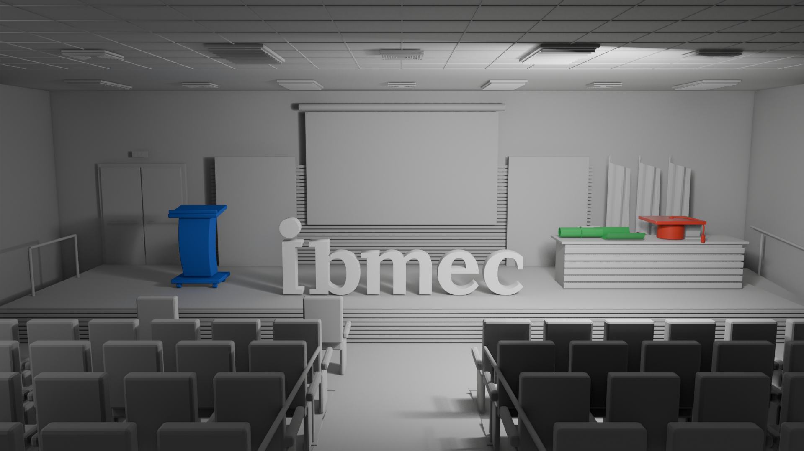

A cena é uma **cópia** de `AP1_IgorRodrigues.blend` — o arquivo da AP1 não é alterado — e tudo é feito por quatro scripts `bpy` encadeados pelo `executar_ac04.py`: a cópia, a iluminação, os materiais e o render. O motor passa do Workbench da AP1 para o **EEVEE**, que calcula as componentes difusa e especular, com gerenciamento de cor **AgX** para não estourar os brilhos.

| Objeto autoral | Material | Cor-base | Roughness | Specular IOR Level | Aparência esperada |
|---|---|---|:---:|:---:|---|
| 🎤 Púlpito | `MAT_Lambert` | 🔵 `#3366CC` | 1.0 | 0.0 | fosca, só difusa — `I = kd·(N·L)` |
| 🎓 Capelo | `MAT_Phong` | 🔴 `#C0392B` | 0.2 | 0.5 | difusa + brilho concentrado |
| 📜 Diploma | `MAT_BlinnPhong` | 🟢 `#2E9E4F` | 0.1 | 0.8 | brilho mais estreito e intenso |

Os valores são os das práticas da aula 11. No Blender 4.5, o antigo *Specular* do **Principled BSDF** se chama *Specular IOR Level*. Por ser um shader físico, o Principled BSDF não implementa literalmente as equações de Phong e Blinn-Phong: as configurações são **aproximações visuais**. O `MAT_Lambert` traz também um nó **Diffuse BSDF** desconectado, como alternativa direta para a componente difusa.

A iluminação é fixa: uma **luz principal Area** em disco de 1 m (300 W, *spread* de 120°) e uma **luz de preenchimento Area** de 4 m (50 W), na coleção `AC04_Iluminacao`. A luz *Sun* foi descartada porque o auditório é fechado e o forro, a 4,2 m, a bloquearia. A principal fica a 3,2 m, do lado do capelo e do diploma: assim o vetor médio **H** entre luz e câmera se aproxima das normais da copa e do canudo, e o brilho aparece para a câmera. As três luzes da AP1 continuam no arquivo, desativadas.

📦 **Entregáveis:**

| | Item | Arquivo |
|:---:|---|---|
| 🟠 | arquivo `.blend` | [`AC04_IgorMariano.blend`](AC4/AC04_IgorMariano.blend) |
| 🐍 | scripts Python (`01` → `04`) | [`scripts/`](AC4/scripts/) |
| 🖼️ | render final (1920×1080, EEVEE) | [`AC04_IgorMariano_render_final.png`](AC4/AC04_IgorMariano_render_final.png) |
| 🔲 | imagem comparativa dos três materiais | 🚧 pendente (etapa 3) |
| 📝 | relatório: objetos, materiais, luzes, comparação e limitações | [`AC04_Relatorio.md`](AC4/AC04_Relatorio.md) |

> [!NOTE]
> A etapa 3 — observar no modo *Rendered*, girar a luz temporariamente e comparar os materiais — fica fora da automação e ainda não foi feita; dela sai a imagem comparativa. A comparação do relatório se baseia no render final e nas prévias feitas ao posicionar a luz.

<details>
<summary><b>📖 Referências da AC4</b></summary>

<br>

* **Práticas da aula 11:** [cena](https://jonh-carvalho.github.io/CG_26.2_8001/Disciplina/docs/aula11/pratica/01_cena/) · [Lambert](https://jonh-carvalho.github.io/CG_26.2_8001/Disciplina/docs/aula11/pratica/2.1_lambert/) · [Phong](https://jonh-carvalho.github.io/CG_26.2_8001/Disciplina/docs/aula11/pratica/2.2_phong/) · [Blinn-Phong](https://jonh-carvalho.github.io/CG_26.2_8001/Disciplina/docs/aula11/pratica/2.3_blinn-phong/) (valores de *Roughness* e *Specular* dos três materiais)
* **Material:** `aula12/Modelo_Iluminação.md` (roteiro dos modelos de iluminação no Blender)
* **Base:** [`AP1/AP1_IgorRodrigues.blend`](AP1/AP1_IgorRodrigues.blend) (cena de origem, só leitura)
* **Externas:** [Principled BSDF — Blender 4.5](https://docs.blender.org/manual/en/4.5/render/shader_nodes/shader/principled.html) · [Luzes — Blender 4.5](https://docs.blender.org/manual/en/4.5/render/lights/light_object.html) · [Blender Python API (`bpy`)](https://docs.blender.org/api/current/)

</details>

---

## 🪵 AC5 — Evolução da cena: materiais PBR e texturas

> 🎯 **Objetivo** ([enunciado da AC05](https://jonh-carvalho.github.io/CG_26.2_8001/Avalia/AC05/)): continuar a cena da AC4, aplicar materiais com **Principled BSDF**, preparar UVs e usar mapas de imagem em pelo menos dois objetos, preservando a composição e a leitura da marca Ibmec.

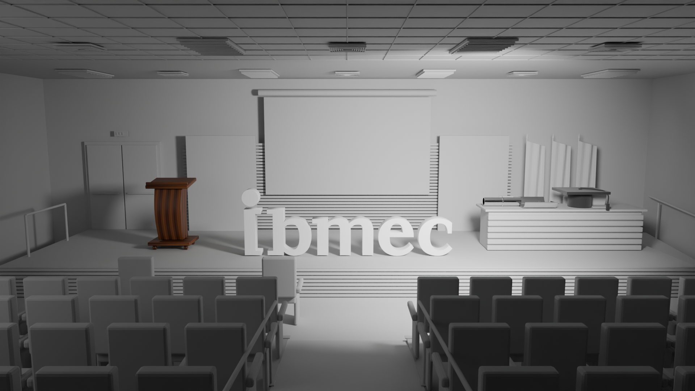

A cena parte de [`AC04_IgorMariano.blend`](AC4/AC04_IgorMariano.blend). A câmera, a geometria, as luzes e o World são preservados. O motor passa de EEVEE para **Cycles CPU**, com **64 amostras e denoising**, para calcular os reflexos do diploma. O render final tem **1920 × 1080** e foi produzido no **Blender 4.5.3 LTS na nuvem**, sem abrir o Blender no computador local.

| Objeto | Material | Cor / textura | Roughness | Metallic |
|---|---|---|---|:---:|
| 🎤 Púlpito | `MAT_Madeira_Nogueira_PBR` | Madeira marrom com veios | Mapa: 0,38–0,58 | 0 |
| 🎓 Capelo | `MAT_Tecido_Preto_PBR` | **Tecido preto**, com trama fina | Mapa: 0,72–0,87 | 0 |
| 📜 Diploma | `MAT_Metal_Espelhado_PBR` | Prata clara, acabamento espelhado | 0,025 | 1 |

O **capelo permanece em tecido preto**, conforme a escolha do projeto. O diploma reúne a aparência metálica e o acabamento espelhado citados no enunciado; essa adaptação está explicitada no relatório. A marca mantém seus materiais e sua leitura, sem receber textura ou relevo.

**Mapas e UVs.** Madeira e tecido recebem, cada um, três PNGs de **1024 × 1024**: Base Color em **sRGB**, Roughness em **Non-Color** e Normal em **Non-Color**, passando pelo nó **Normal Map** antes do Principled BSDF. Os seis mapas são sintéticos, gerados pelo script com assistência de IA e disponibilizados sob **CC0-1.0**; a origem está em [`FONTES_E_LICENCA.json`](AC5/texturas/FONTES_E_LICENCA.json). As imagens estão empacotadas no `.blend` e também acompanham a entrega em [`texturas/`](AC5/texturas/).

As duas malhas texturizadas usam `UV_AC05`, criada com **Smart UV Project**, limite angular de **66°** e margem de **0,025**. O script considera a escala do objeto na projeção e restaura as coordenadas da geometria. A força do Normal Map é **0,25** na madeira e **0,18** no tecido; no enquadramento geral, a trama fina do capelo aparece de forma sutil.

| Shader Editor — mapas e conexões | UV Editor — ilhas do púlpito |
|---|---|
| 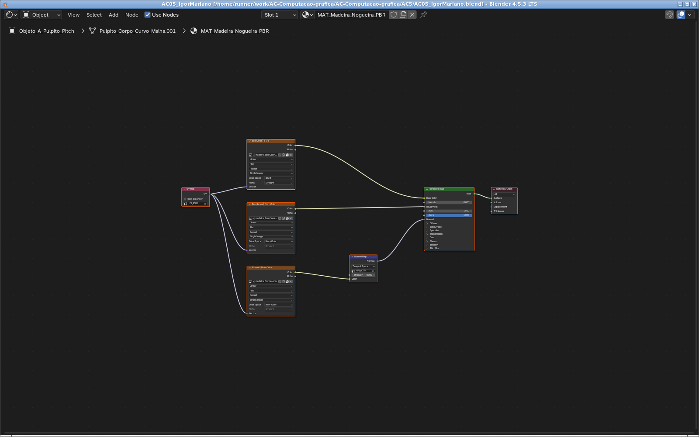 | 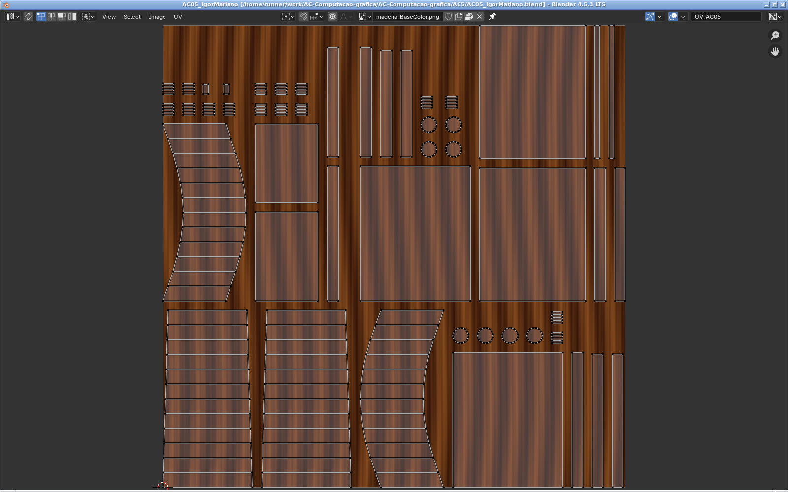 |

As duas imagens são **capturas reais da interface do Blender**, obtidas em uma sessão gráfica virtual Linux com Xvfb, Openbox e `scrot`. O [render](https://github.com/IgorMariano25/AC-Computacao-grafica/actions/runs/42702894498) e as [capturas finais](https://github.com/IgorMariano25/AC-Computacao-grafica/actions/runs/42705087078) têm registros públicos no GitHub Actions.

📦 **Entregáveis versionados:**

| Item | Arquivo |
|---|---|
| Cena final com texturas empacotadas | [`AC05_IgorMariano.blend`](AC5/AC05_IgorMariano.blend) |
| Render da câmera principal | [`AC05_render_final.png`](AC5/imagens/AC05_render_final.png) |
| Capturas de nós e UVs | [`AC05_ShaderEditor.png`](AC5/imagens/AC05_ShaderEditor.png) · [`AC05_UVEditor.png`](AC5/imagens/AC05_UVEditor.png) |
| Relatório de materiais, mapas, UVs e iluminação | [`Relatorio_AC05_IgorMariano.md`](AC5/Relatorio_AC05_IgorMariano.md) |
| Preparação da cena e render | [`preparar_ac5.py`](AC5/scripts/preparar_ac5.py) |
| Geração dos mapas | [`gerar_texturas.py`](AC5/scripts/gerar_texturas.py) |
| Capturas reais dos editores | [`capturar_editores.py`](AC5/scripts/capturar_editores.py) |
| Seis mapas e licença | [`texturas/`](AC5/texturas/) |

📄 Instruções completas em [`AC5/README.md`](AC5/README.md).

<details>
<summary><b>📖 Referências da AC5</b></summary>

<br>

* **Aula 12:** [Materiais](https://jonh-carvalho.github.io/CG_26.2_8001/Disciplina/aula12/01_Materiais/) · [Texturas em computação gráfica](https://jonh-carvalho.github.io/CG_26.2_8001/Disciplina/aula12/03_Texturas/) · [UV Unwrapping](https://jonh-carvalho.github.io/CG_26.2_8001/Disciplina/aula12/04_UVWraping/) · [Texturas no Blender](https://jonh-carvalho.github.io/CG_26.2_8001/Disciplina/aula12/05_TexturasBlender/).
* **Base:** cena da AC4, mantendo a modelagem da AP1.
* **Documentação:** [Blender 4.5 LTS](https://docs.blender.org/manual/en/4.5/). Os mapas foram gerados para o projeto; não foram usadas imagens de Poly Haven ou ambientCG.

</details>

---

## 🔗 Continuidade das entregas e organização no Git

| Etapa | Resultado | Continuidade |
|---|---|---|
| **AP1** | Auditório e três objetos autorais, composição estática em cinza | Base original preservada |
| **AC4** | Materiais de comparação e iluminação fixa, render EEVEE | Cópia da AP1; comparação experimental ainda pendente na versão documentada |
| **AC5** | Madeira, tecido preto e metal espelhado, UVs e mapas PBR | Cópia da AC4; render Cycles e capturas reais concluídos |

A branch **`AC5`** organiza os arquivos essenciais da entrega. A branch **`codex/ac5-blender-cloud`** registra a execução técnica, com workflow, logs e cópias auxiliares. Elas têm finalidades diferentes; a versão organizada para entrega é a da branch `AC5`, cujos arquivos estão descritos neste índice.

O [`.gitignore`](.gitignore) mantém fora do versionamento da AC5 o ZIP de entrega, as prévias antigas de IA, os logs, os registros auxiliares, a infraestrutura de nuvem e a cópia local de entrada `base_AC4/`. Esses arquivos permanecem no computador. Os arquivos essenciais — cena, imagens finais, relatório, README, três scripts e seis mapas com licença — estão versionados. A reprodução pode usar a AC4 que já existe no repositório, sem depender da cópia local ignorada.

---

## 🚀 Como executar

As atividades **AC1 e AC2** trazem `requirements.txt` para execução em Python 3.12. Os scripts de cena das atividades Blender usam o Python embutido do Blender 4.5 LTS:

```bash
# 1️⃣ ambiente virtual
python -m venv .venv
.venv\Scripts\activate                 # Windows

# 2️⃣ dependências da atividade
pip install -r AC1/requirements.txt    # ou AC2/requirements.txt

# 3️⃣ execução
python AC1/executar_tudo.py
python AC2/executar_tudo.py
```

A **AC3 não usa esse ambiente**: ela roda no Python embutido do Blender 4.5 LTS. Abra o `.blend`, vá na aba *Scripting*, carregue [`AC3/AC03_IgorMariano.py`](AC3/AC03_IgorMariano.py) e execute com `Alt+P` — o script limpa a coleção `AC03_transformacoes` antes de recriá-la, então pode ser reexecutado sem duplicar objetos.

A **AP1** também é só o `.blend`: abra [`AP1/AP1_IgorRodrigues.blend`](AP1/AP1_IgorRodrigues.blend) no Blender 4.5 LTS (`Numpad 0` para a câmera principal, `F12` para renderizar). Nenhum script é necessário.

A **AC4** também roda no Python do Blender 4.5 LTS e parte da AP1: abra [`AP1/AP1_IgorRodrigues.blend`](AP1/AP1_IgorRodrigues.blend), vá na aba *Scripting*, carregue [`AC4/scripts/executar_ac04.py`](AC4/scripts/executar_ac04.py) e execute com `Alt+P`. O primeiro script salva a cópia `AC4/AC04_IgorMariano.blend` e passa a trabalhar nela; os scripts 02 a 04 se recusam a rodar em outro arquivo, então o `.blend` da AP1 nunca é sobrescrito. Para rodar sem abrir a interface, a partir da raiz do repositório:

```bash
blender -b AP1/AP1_IgorRodrigues.blend --python AC4/scripts/executar_ac04.py
```

A **AC5** já inclui o `.blend` final e as imagens: não é necessário executar scripts para consultar a entrega. Para reproduzir a preparação e o render, preserve antes o arquivo final existente em outro local, pois o script recusa sobrescrevê-lo. A partir da raiz do repositório:

```bash
blender -b --python-exit-code 1 --python AC5/scripts/preparar_ac5.py -- --render
```

O script utiliza `AC5/base_AC4/AC04_IgorMariano.blend`, se essa cópia local existir, ou `AC4/AC04_IgorMariano.blend` em um clone do repositório. Para preparar sem renderizar, retire `-- --render`. Os mapas já estão incluídos; para regenerá-los, execute `python AC5/scripts/gerar_texturas.py` em um ambiente com **NumPy**. As capturas dos editores exigem sessão gráfica Linux com Xvfb, Openbox e `scrot`, conforme as [instruções da AC5](AC5/README.md#reprodução-em-blender-45-lts).

<div align="center">

---

🎓 **Computação Gráfica I** &nbsp;·&nbsp; ✅ AP1 &nbsp; 🚧 AP2 &nbsp; ✅ AC1 &nbsp;·&nbsp; ✅ AC2 &nbsp;·&nbsp; ✅ AC3 &nbsp;·&nbsp;  ✅ AC4 &nbsp;·&nbsp; ✅ AC5

</div>
